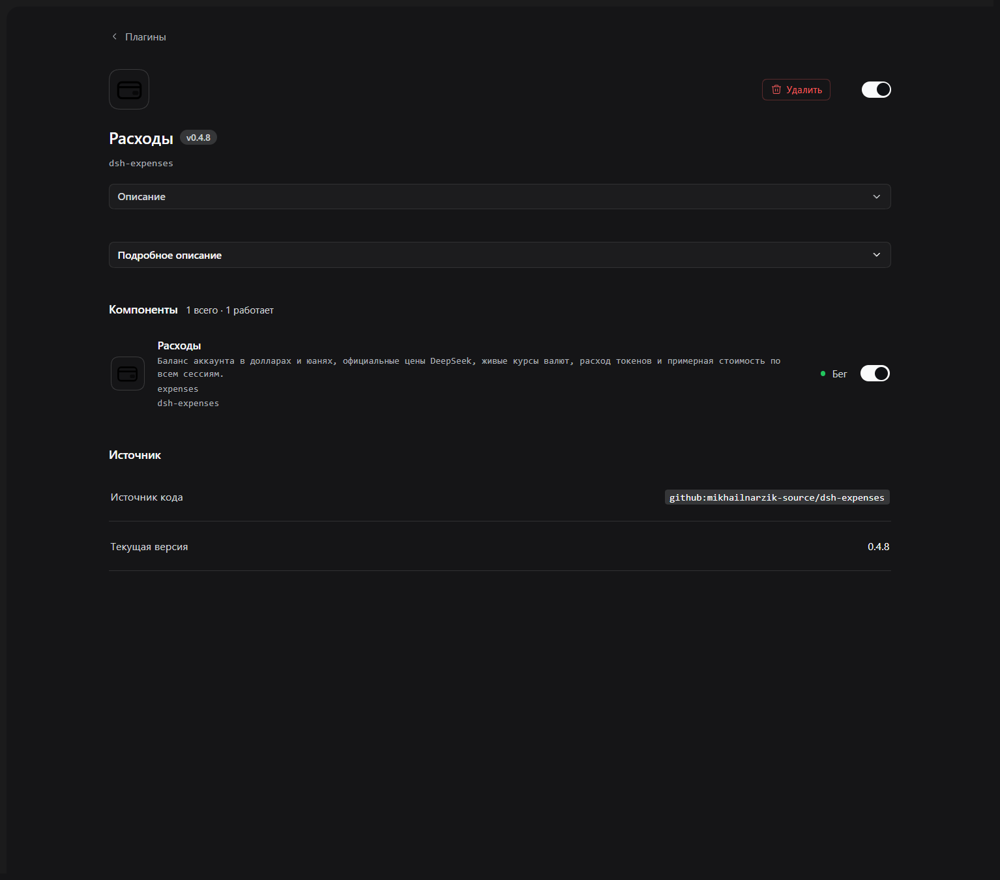

# Расходы (dsh-expenses)

Панель «Расходы» для DeepSeek Harness: показывает, сколько токенов тратит
ассистент, во что это примерно обходится в деньгах и какой сейчас баланс
аккаунта DeepSeek.



*Страница плагина в интерфейсе DSH.*

## Что это и зачем

DeepSeek Harness (DSH) — приложение, в котором вы переписываетесь с ассистентом.
За каждый ответ модель списывает деньги с баланса вашего аккаунта DeepSeek.
Плагин собирает статистику и показывает её одной страницей.

Простые слова, которые встретятся дальше:

- **токен** — кусочек текста, которым модель считает объём работы; цена указана
  за миллион токенов;
- **сессия** — один диалог в DSH, он выбран в списке слева;
- **кэш-хит** — часть вопроса, которую модель уже видела раньше; такие токены
  дешевле;
- **кэш-мисс** — новый текст вопроса, он стоит дороже кэш-хита;
- **вход / выход** — токены вопроса (вход) и токены ответа (выход);
- **субагент** — помощник, которого агент запускает внутри задачи; в таблице у
  него есть бейдж «субагент».

Зачем это нужно: понять, какие задачи дорогие, сколько уходит за день, когда
пора пополнить баланс и не подорожали ли модели. Плагин ничего не покупает и не
тратит: он только читает журналы сессий DSH и показывает цифры.

## Как открыть

1. Левая панель DSH → **«Расходы»** (иконка в виде листка-чека в списке
   разделов). Откроется страница с балансом, ценами и таблицей сессий.
2. Карточка плагина и подробная документация: левая панель → **«Плагины»** →
   карточка **«Расходы»** → раздел **«Подробности»**.
3. Чтобы видеть **баланс**, войдите в аккаунт DeepSeek: **«Настройки» →
   «Аккаунт»**. Без входа страница тоже работает: расходы и цены видны, а на
   месте баланса будет подсказка.

## Как пользоваться пошагово

**Сценарий 1. Сколько потрачено сегодня.**

1. Откройте «Расходы» — данные загрузятся сами.
2. Сверху две карточки: **«Сегодня»** и **«За всё время»**. В каждой крупная
   сумма в выбранной валюте и четыре числа: «Вход», «Выход», «Запросы»,
   «Инструменты».
3. Рядом с заголовком видно время последнего обновления. Кнопка **«Обновить»**
   перечитывает всё заново, **«Проверить обновления»** — ищет новую версию
   плагина.
4. Валюту меняйте в блоке цен: селектор **₽ / $ / ¥**. Выбор запоминается.

**Сценарий 2. Найти самую дорогую сессию.**

1. Прокрутите к таблице. По умолчанию первая колонка — сессия, дальше дата,
   токены, запросы, инструменты и стоимость.
2. Нажмите на заголовок **«Стоимость»** — таблица отсортируется по цене; повторный
   клик меняет направление. Так же сортируется любая колонка.
3. В строке поиска наберите часть названия сессии. Галочки **«Только сегодня»**
   и **«Без субагентов»** сужают список.
4. Под таблицей строка «Показано X из Y · Стоимость выбранных: …» — это итог
   только по видимым строкам. Кнопка «Сбросить фильтры» возвращает всё.

**Сценарий 3. Баланс и пополнения.**

1. Блок **«Баланс»**: карточки «Доллары» и «Юани». В каждой итог и две строки —
   «Пополняемый» и «Бонусный».
2. Рядом блок **«Последние пополнения»**: дата и сумма. Кнопка **«Показать всю
   историю (N)»** раскрывает список целиком, «Свернуть историю» прячет обратно,
   внизу — «Всего пополнено».
3. Ссылка **«Пополнить ↗»** открывает страницу пополнения на сайте DeepSeek;
   сам плагин деньги не переводит.

**Сценарий 4. Проверить цены и курс.**

1. Блок **«Цены DeepSeek за 1 млн токенов»** показывает модели и три цены:
   кэш-хит, кэш-мисс, выход.
2. Рядом с названием — время, когда цены прочитаны с сайта, и пометка «цены
   обновились», «без изменений» или «цены могли устареть».
3. Строка **«Курс»** внизу блока: сколько рублей за доллар и юань. Если курс
   недоступен, суммы показываются в долларах.

## Примеры

**Как считаются токены.** Плагин читает журнал каждой сессии DSH и складывает
только реальные ответы модели:

| Показатель | Что складывается |
| --- | --- |
| Вход | токены кэш-мисс (новый текст вопроса) + токены кэш-хит (уже виденный текст) |
| Выход | токены ответа модели |
| Запросы | число ответов модели (одно сообщение = один запрос) |
| Инструменты | число вызовов инструментов |

У сессий, созданных копированием («форк»), унаследованная часть не считается
второй раз: она уже оплачена в исходной сессии.

**Как считается стоимость.** Для каждого ответа плагин берёт официальную цену
DeepSeek за миллион токенов и умножает на потраченное:

```text
цена = (кэш-хит × цена кэш-хита
      + кэш-мисс × цена кэш-мисса
      + выход × цена выхода) / 1 000 000   (в долларах США)
```

- цены читаются с официальной страницы DeepSeek и обновляются сами (кэш на
  шесть часов); если сайт недоступен, используется встроенная резервная таблица;
- в часы пик цена выше, в непиковые — ниже; плагин сам определяет период по
  времени сообщения. Праздники Китая при этом не учитываются;
- для устаревших названий моделей (`deepseek-chat`, `deepseek-reasoner` и т. п.)
  берётся цена их современного аналога;
- пример: миллион токенов кэш-мисс входа для младшей модели вне пик стоит
  **$0,15** — страница покажет то же число, переведённое в рубли по текущему
  курсу.

**Как доллары превращаются в рубли.** Цены и стоимость сначала считаются в
долларах, затем переводятся по живому курсу: доллар → рубль, юань → рубль,
юань → доллар. Курсы приходят с публичного сервиса и обновляются вместе со
страницей. Поэтому итог — **примерная** цифра: курс меняется, а скидки и
промо-тарифы DeepSeek плагин не знает.

**Пополнения.** Плагин запоминает пополняемый баланс и записывает пополнение,
когда баланс вырос. Первое открытие страницы только запоминает текущий баланс,
поэтому история начинается с ближайшего пополнения. Если пополнение совпало с
расходом, сумма может быть неточной.

**Куда пропадает история сессий.** Список сессий сохраняется в файл
`~/.dsh/dsh-expenses/sessions.json` (до 5000 сессий). Поэтому удалённая сессия
остаётся в таблице с бейджем **«удалена»**, и её стоимость по-прежнему входит в
итоги.

## Что вы увидите

**Страница «Расходы».**

- Шапка: название, подпись, версия плагина, время обновления, кнопки
  «Проверить обновления» и «Обновить».
- Две карточки-итога — «Сегодня» и «За всё время».
- Блок цен: валюта, ссылка «Источник ↗», список моделей с тремя ценами и строка
  курса.
- Блок баланса с карточками валют и блок последних пополнений.
- Таблица сессий: колонки «Сессия», «Дата», «Вход», «Выход», «Запросы»,
  «Инструменты», «Стоимость»; бейджи «субагент» и «удалена».
- Панель над таблицей: поиск, галочки фильтров, счётчик показанных строк и
  итог по выбранным.
- Баннер обновления, если вышла новая версия.

**Подсказки.** Если навести курсор на число «Вход», всплывёт «из них из кэша:
N». Стоимость в строке без цены показывается прочерком, а недоступный журнал
сессии помечается «Лог сессии недоступен».

**Карточка плагина.** В «Плагинах» у «Расходов» видны название, описание, версия
и раздел «Подробности» с этим документом.

## Частые ошибки и что делать

| Симптом | Причина | Что сделать |
| --- | --- | --- |
| «Аккаунт DeepSeek не подключён» | нет входа в аккаунт | «Настройки» → «Аккаунт» → войти; баланс появится без перезапуска |
| «Не удалось получить баланс» | сеть или сервис аккаунта недоступен | нажать «Обновить»; проверить интернет; войти заново |
| «Курс недоступен» | сервис курсов не ответил | суммы показываются в долларах; нажать «Обновить» позже |
| «Не удалось прочитать цены с сайта» | нет сети или сайт изменил разметку | используется резервная таблица; стоимость остаётся примерной |
| «Цены могли устареть» | давно не обновлялись | нажать «Обновить»; проверка повторится |
| История пополнений пуста | плагин ещё не видел роста баланса | это нормально после установки; пополнение появится при следующем росте |
| «Сессий пока нет» | в DSH ещё не было диалогов | задать любой вопрос ассистенту |
| Стоимость в строке «—» | журнал сессии недоступен или цену не удалось посчитать | сессия слишком старая или повреждена; остальные строки считаются нормально |
| «Лог сессии недоступен» | журнал сессии не читается | строка останется в истории, но без цифр |
| После обновления плагина ничего не изменилось | новая версия подхватывается при перезапуске | перезапустить DSH или нажать «Перезагрузить» в баннере обновления |

## Ограничения и безопасность

- Плагин **только читает** журналы сессий DSH и данные аккаунта. Он не отправляет
  сообщения модели, не тратит деньги и не пополняет баланс: ссылка «Пополнить»
  просто открывает сайт DeepSeek.
- В сеть плагин ходит только за официальными ценами DeepSeek и курсами валют.
  Ничего из переписки наружу не уходит.
- Стоимость **примерная**: кэш-хиты, пиковые часы и курс учитываются, а скидки,
  промо-тарифы и праздничные дни — нет.
- Баланс виден только при подключённом аккаунте DeepSeek; при работе по одному
  API-ключу сервис баланса может быть недоступен.
- Пополнения фиксируются только с момента установки плагина и только пока DSH
  открыт: страница обновляет баланс раз в 20 секунд, фоновая проверка — раз в
  минуту.
- Валюта, сортировка, фильтры и история пополнений хранятся в браузере на этом
  компьютере, а не в профиле DSH. Очистка данных браузера их сбросит; история
  сессий в `~/.dsh/dsh-expenses/sessions.json` при этом останется.
- Плагин личный, без гарантий; исходный код можно читать и менять.

## Связанные плагины

- **dsh-team** — помогает собрать задание для нескольких субагентов. Каждый
  субагент считается отдельной сессией: в таблице у него бейдж «субагент», а
  галочка «Без субагентов» убирает такие строки.
- **dsh-compact** — сжимает длинный диалог в короткую выжимку без нейросети. Чем
  короче история, тем меньше входных токенов в следующих запросах.
- **dsh-review** — ревью, тесты и коммит через ассистента. Расходы на эту работу
  видны в общей таблице.
- **dsh-notify** — сообщит, когда задача завершилась или ждёт вашего решения.
  Вместе с «Расходами» удобно смотреть, сколько такая задача стоила.
- **dsh-sync** — переносит историю сессий между компьютерами. Архив расходов
  лежит локально в `~/.dsh/dsh-expenses/` и отдельно не синхронизируется.

## Установка и обновление

Установка из репозитория:

```powershell
dsh plugin --profile desktop add github:mikhailnarzik-source/dsh-expenses
```

То же самое можно сделать в интерфейсе: **«Плагины» → «Добавить плагин»** и
вставить `github:mikhailnarzik-source/dsh-expenses`. После установки
перезапустите DSH.

Обновление: кнопка «Проверить обновления» на странице «Расходы». Если версия
новее, появится баннер с кнопкой «Установить». Обновление не ставится молча:
его запускает человек, после установки нужен перезапуск DSH.
