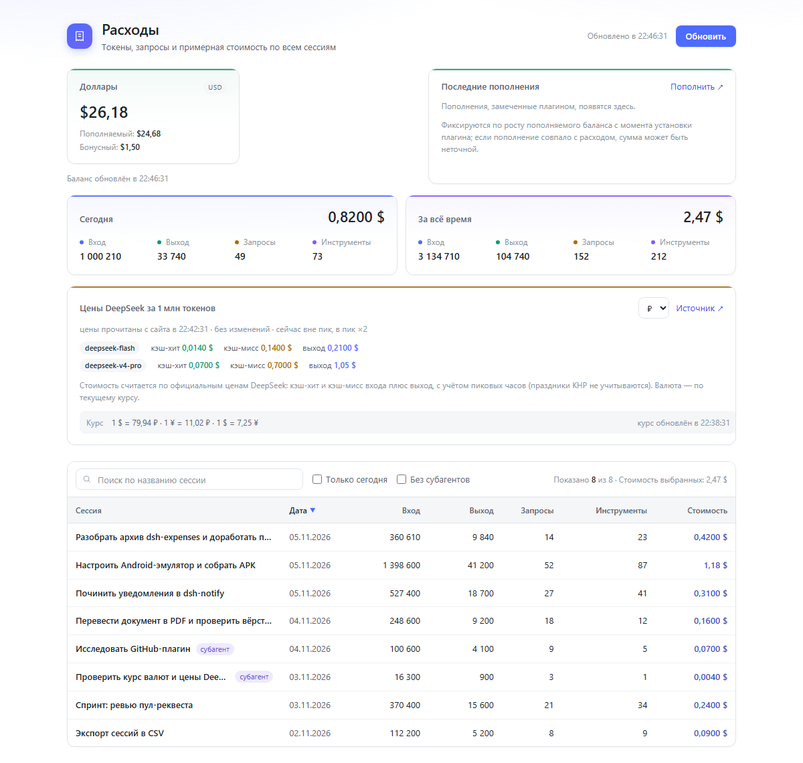
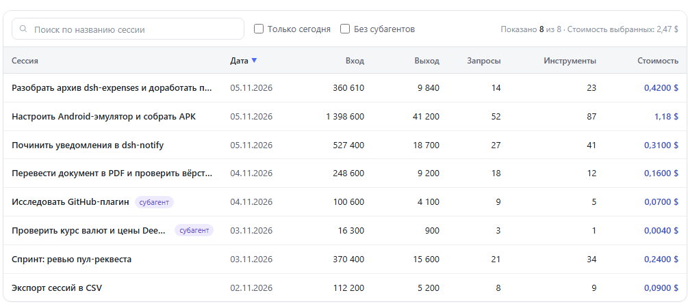

# dsh-expenses

Панель «Расходы» для [DeepSeek Harness](https://github.com/deepseek-ai): сколько
токенов сожгла каждая сессия, сколько было запросов к модели и во что это
примерно обошлось — плюс баланс аккаунта в долларах, юанях или рублях.

Плагин личный, но устроен как обычный bundle DSH: ставится из интерфейса,
обновляется переустановкой, удаляется одной кнопкой.



*Панель считается по логам сессий этого компьютера: баланс, токены за сегодня и
за всё время, цены DeepSeek и таблица сессий. Оформление следует теме Harness —
светлая и тёмная палитры поддерживаются автоматически.*

## Что показывает

- **По каждой сессии**: входные и выходные токены, из них из кэша, число
  запросов к модели, вызовы инструментов, примерная стоимость.
- **Поиск и сортировка**: фильтр по названию сессии, сортировка по любому
  столбцу (клик по заголовку), переключатели «Только сегодня» и «Без
  субагентов», плюс стоимость выбранных строк.
- **За сегодня** по всем сессиям — отдельной строкой.
- **Баланс** аккаунта DeepSeek: доллары, юани или рубли (курс подтягивается).
- **Цены DeepSeek** за 1 млн токенов — прямо в панели, чтобы было видно, из чего
  сложилась оценка.
- **Обновления**: при запуске DSH (и раз в 6 часов) плагин проверяет свежий
  `main` на GitHub, показывает карточку с предложением обновиться, а кнопка
  «Проверить обновления» в шапке запускает проверку вручную.



Стоимость считается локально по таблице цен; в сеть уходит только запрос баланса
тех же учётных данных, что использует сам Harness.

## Требования

- DeepSeek Harness 0.2.x с веб-клиентом (проверено на 0.2.2-rc.1).
- Никаких внешних зависимостей и шага сборки: чистый ESM, React даёт хост.

## Установка через интерфейс (рекомендуется)

1. Откройте DeepSeek Harness → боковая панель → **Плагины**.
2. В поле установки плагина вставьте адрес репозитория:

   ```
   https://github.com/mikhailnarzik-source/dsh-expenses
   ```

3. Нажмите установить и дождитесь окончания (виден лог pnpm).
4. Перезапустите Harness, если интерфейс попросит.

То же самое короче: `github:mikhailnarzik-source/dsh-expenses`.

Репозиторий публичный специально: менеджер плагинов проверяет доступность
репозитория до установки, отключив запросы паролей, — с приватным репозиторием
на новом компьютере установка упрётся в авторизацию.

## Установка из локальной копии

Если хочется держать исходники рядом и править их:

```powershell
git clone https://github.com/mikhailnarzik-source/dsh-expenses.git
cd dsh-expenses
dsh plugin --profile desktop add "link:$PWD"
```

Команда сама пропишет зависимость и добавит bundle в профиль. Дальше — перезапуск
Harness. Правки в `index.js` / `client.js` подхватываются после перезапуска.

## Обновление

Плагин обновляет себя сам. При старте DSH и далее раз в шесть часов он читает
`package.json` из `main` на GitHub; для `link:`-копии дополнительно делает
`git fetch` и сравнивает коммиты. Если версия новее, в углу появляется
карточка «Доступно обновление» с кнопками **Установить** и **Позже**, а в шапке
панели есть кнопка **Проверить обновления**.

Установка зависит от способа подключения:

- `link:`-копия (git-репозиторий) — `git pull --ff-only` в этой копии;
- установка из GitHub через pnpm — `pnpm update dsh-expenses` в активном
  профиле. Используется pnpm, который поставляет сам DSH.

Локальные незакоммиченные изменения блокируют обновление, чтобы ничего не
потерять. После установки перезапустите DSH или обновите страницу — работающий
клиент держит старую версию в памяти.

При желании можно обновиться и вручную: **Плагины** → удалить `dsh-expenses` →
установить заново, либо из локальной копии — `git pull`.

## Удаление

**Плагины** → у `dsh-expenses` кнопка удаления. Или вручную:

```powershell
dsh plugin --profile desktop remove dsh-expenses
```

## Проверка, что работает

1. В боковой панели появился пункт «Расходы».
2. В нём видна таблица сессий и строка баланса.
3. Если баланс не подтянулся, а сессии считаются — значит нет доступа к
   `/api/expenses.balance` у текущего провайдера; остальное работает независимо.

## Настройки

Панель запоминает в `localStorage` выбранную валюту и набор кошельков
(`dsh-expenses:balance-wallets`), сортировку и фильтры таблицы
(`dsh-expenses:table-sort`, `dsh-expenses:table-filters`), а также скрытую
версию обновления (`dsh-expenses:update-dismissed`). Это настройки браузера,
а не профиля: на другом компьютере они начнутся с значений по умолчанию.

## Как устроено

| Файл | Что делает |
| --- | --- |
| `index.js` | Host-половина: читает логи сессий через `sessionQuery`, считает токены, запросы, вызовы инструментов и стоимость; отдаёт `/api/expenses.overview`, баланс — `/api/expenses.balance` |
| `client.js` | Браузерная половина: панель в сайдбаре, поиск, фильтры и сортировка таблицы, баланс, цены |
| `update.js` | Проверка обновлений на GitHub, сравнение версий и коммитов, установка через `git pull` или `pnpm update` |
| `cordis.patch.yml` | Вставка строки плагина в дерево профиля |
| `package.json` | Манифест: `dsh.bundle.patch` + `dsh.client` |
| `locale/*.json` | Подписи на русском и английском |

Числа считаются по зафиксированным событиям сессии, поэтому повторный запуск
ничего не удваивает; форк-наследованные события не учитываются — их уже оплатила
исходная сессия.

## Статус и лицензия

Личный эксперимент, без гарантий. Код можно брать и переделывать под себя.
