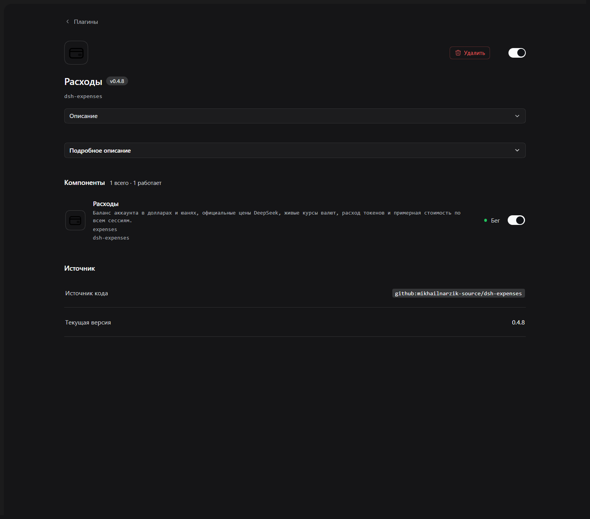

# Расходы — подробное описание

Плагин `dsh-expenses` добавляет в DeepSeek Harness страницу «Расходы»: баланс
аккаунта, официальные цены моделей, курсы валют, расход токенов и примерную
стоимость каждой сессии. Этот файл — подробное руководство; краткая версия — в
`README.md` плагина.

## Что это и зачем

DSH — приложение для общения с ассистентом. Каждый ответ модели расходует
токены и деньги с баланса аккаунта DeepSeek. Плагин сам находит все сессии,
складывает их токены, умножает на официальные цены и показывает итог — по
каждой сессии, за сегодня и за всё время.

Термины:

- **токен** — единица объёма текста для модели; цена указывается за 1 000 000
  токенов;
- **сессия** — один диалог в DSH (список слева);
- **кэш-хит** — токены вопроса, которые модель уже видела: они дешевле;
- **кэш-мисс** — новые токены вопроса;
- **вход / выход** — токены вопроса / токены ответа;
- **пик и непик** — периоды суток, в которые официальная цена разная;
- **субагент** — помощник, запущенный агентом внутри задачи;
- **форк сессии** — копия диалога, у которой есть унаследованная часть.

Зачем: видеть дорогие задачи и дневной расход, проверять баланс и следить за
изменением цен. Плагин ничего не покупает: он только читает данные и считает.

## Как открыть

1. Левая панель DSH → **«Расходы»**. Иконка — листок-чек; страница открывается
   в основной области.
2. Страница «Расходы» открывается в основной области. В шапке — название, версия
   плагина, время обновления, кнопки «Проверить обновления» и «Обновить».
3. Карточка плагина: **«Плагины» → «Расходы»**. В карточке — описание, версия и
   раздел **«Подробности»** (этот документ).
4. Для баланса нужен подключённый аккаунт DeepSeek: **«Настройки» → «Аккаунт»**.
   Без входа страница работает, но вместо баланса будет подсказка
   «Аккаунт DeepSeek не подключён».

## Как пользоваться пошагово

1. **Первое открытие.** Данные загружаются сами: карточки «Сегодня» и «За всё
   время», цены, курс, баланс (если аккаунт подключён) и таблица сессий.
2. **Обновить.** Кнопка «Обновить» перечитывает сессии, баланс и курс заново.
   Кнопка «Проверить обновления» ищет новую версию плагина на GitHub.
3. **Валюта.** В блоке цен выберите ₽, $ или ¥. Все суммы на странице сразу
   пересчитаются; выбор запоминается в браузере.
4. **Найти нужное.** Над таблицей есть фильтры: **период** (сегодня, 7 дней,
   30 дней, всё время или свои даты «с»/«по»), **диапазоны стоимости** и
   **токенов** («от» и «до»), **поиск** по названию сессии или модели и галочки
   «Только сегодня» / «Без субагентов». Сортировка — клик по заголовку колонки:
   дата, токены, стоимость и остальные колонки, повторный клик меняет
   направление. «Сбросить фильтры» очищает все условия, но не сортировку.
   Таблица показывает **30 сессий на страницу**: под ней кнопки ◀ ▶ и подпись
   «Стр. X из Y»; номер страницы живёт, пока открыта страница «Расходы».
5. **Баланс и пополнения.** Баланс и «Последние пополнения» стоят в одном ряду.
   В карточке баланса — итоги по валютам, строки «Пополняемый» / «Бонусный» и
   четыре метрики: расход **сегодня**, за **7 дней**, **средний расход на
   сессию** и **курс** доллара. Кнопка **«Пополнить ↗»** открывает сайт
   пополнения DeepSeek. История пополнений листается по **5 записей**; если
   записей не больше пяти, страниц нет.
6. **Стоимость выбранных.** Над таблицей счётчик «Показано X из Y» и сумма только
   по строкам, оставшимся после фильтров — удобно, когда отфильтровали одну
   сессию.
7. **Обновление плагина.** Если доступна новая версия, появится баннер. Нажмите
   «Установить», дождитесь окончания и перезапустите DSH (или нажмите
   «Перезагрузить», когда обновление уже установлено).

## Примеры

**Как считаются токены.** Для каждой сессии берутся только реальные ответы
модели:

| Показатель | Что складывается |
| --- | --- |
| Вход | `inputTokens` (кэш-мисс) + `cacheReadTokens` (кэш-хит) |
| Выход | `outputTokens` |
| Запросы | число сообщений модели |
| Инструменты | число вызовов инструментов |

У форк-сессий унаследованная часть пропускается: она уже оплачена в исходной
сессии, и второй раз её считать нельзя. Сессии субагентов помечаются бейджем.
Удалённые сессии остаются в архиве тоже с бейджем.

**Как считается стоимость.** Один ответ модели:

```text
USD = (кэш-хит × цена_кэш-хита[период]
     + кэш-мисс × цена_кэш-мисса[период]
     + выход × цена_выхода[период]) / 1 000 000
```

- цены — официальные, с сайта DeepSeek; плагин читает их страницу и держит в
  кэше шесть часов, чтобы не дёргать сайт постоянно. Если прочитать не удалось,
  используется встроенная резервная таблица, а в блоке цен появляется пометка
  «цены могли устареть»;
- период (пик/непик) определяется по времени сообщения; в пиковые часы цена
  выше примерно в два раза. Праздники Китая не учитываются: будний день
  праздника считается рабочим;
- для старых названий моделей (`deepseek-chat`, `deepseek-reasoner`,
  `deepseek-v4-flash-vision-exp`) берётся цена актуального аналога;
- если модель неизвестна, используется первая строка таблицы — как
  приблизительная оценка.

**Перевод в рубли.** Стоимость считается в долларах, а затем переводится по
живому курсу в выбранную валюту. Курсы берутся у публичных сервисов; валюты
связаны через рубль: доллар → рубль, юань → рубль, доллар → юань. Если курс
недоступен, страница показывает доллары, чтобы не придумывать цифру.

**Пример.** Сессия: 100 000 токенов кэш-мисс входа и 50 000 токенов выхода.
Берём цену младшей модели вне пик: $0,15 за миллион кэш-мисс входа и $0,60 за
миллион выхода.

```text
0,1 × 0,15 + 0,05 × 0,60 = 0,015 + 0,03 = $0,045
```

Страница покажет стоимость в выбранной валюте — например, деньги, близкие к
4–5 рублям по текущему курсу (точное число зависит от курса).

**Откуда берётся баланс.** Плагин обращается к сервису аккаунта DeepSeek в DSH
и получает два кошелька — долларовый и юаневый, — с разбивкой на пополняемый и
бонусный. Если аккаунт не подключён, баланс не показывается.

**Как считаются метрики баланса.** «Сегодня» — это сегодняшняя часть стоимости
по журналам сообщений (та же цифра, что в карточке «Сегодня»). «За 7 дней» —
стоимость сессий, созданных за последние семь дней, то есть по дате создания
сессии, а не по дате каждого сообщения: сессия, начатая неделю назад и активная
сегодня, целиком попадёт в «за всё время», а её сегодняшняя часть — в «Сегодня».
«Средний расход» — стоимость всех сессий, делённая на число сессий с известной
ценой. «Курс» — текущее значение доллара в рублях (если курс недоступен, вместо
числа будет «Курс недоступен»).

**Пополнения.** Плагин запоминает пополняемый баланс при каждом чтении и
записывает пополнение, когда баланс вырос. Отсюда правила:

- первое чтение только запоминает баланс — история с этого момента;
- если пополнение совпало с расходом, зафиксированная сумма может быть меньше
  фактической;
- запись появляется при следующем обновлении баланса: страница опрашивает его
  раз в 20 секунд, а фоновая проверка — раз в минуту, пока DSH открыт.

**Файлы данных.** История сессий сохраняется в
`~/.dsh/dsh-expenses/sessions.json` (до 5000 сессий) — поэтому стоимость
удалённых сессий не теряется. Архив обновляется не чаще раза в 15 секунд.
Кэш курсов и журнал событий лежат в том же каталоге.

## Что вы увидите

**Шапка.** Заголовок «Расходы», подпись «Токены, запросы и примерная стоимость
по всем сессиям», версия плагина, «Обновлено в ЧЧ:ММ» и две кнопки.

**Карточки-итоги.** «Сегодня» и «За всё время»: крупная стоимость и четыре
метрики. Наведите курсор на «Вход» — всплывёт «из них из кэша: N».

**Цены.** Название, время чтения, пометка состояния, выбранная валюта, ссылка
«Источник ↗», период («сейчас пик (×2)» или «сейчас вне пик, в пик ×2»), строки
моделей с ценами кэш-хита, кэш-мисса и выхода, пояснение и строка курса.

**Баланс.** Карточка «Баланс»: итог по долларам и юаням, строки «Пополняемый» и
«Бонусный», четыре метрики — «Сегодня», «За 7 дней», «Средний расход» и «Курс»,
а внизу кнопка «Пополнить ↗». Рядом — «Последние пополнения»: по пять записей на
страницу, кнопки ◀ ▶ при нескольких страницах, сумма «Всего пополнено» и
пояснение, откуда берутся записи. Карточки в этом ряду одной высоты.

**Таблица.** Сессии с датой, токенами, запросами, инструментами и стоимостью.
Бейджи: «субагент» и «удалена» (при наведении на «удалена» — подсказка, что
стоимость удалённых сессий входит в итоги; при наведении на строку видно и
модели сессии). Над таблицей — строка поиска и фильтры, под таблицей — страницы
по 30 сессий.

**Баннер обновления.** Появляется, когда вышла новая версия: что нового,
«Установить», «Позже». После установки — «Перезагрузить» и подсказка
перезапустить DSH.

**Карточка в «Плагинах».** Название «Расходы», описание, версия, раздел
«Подробности». Отдельного включателя у панели нет: если плагин установлен и
включён, пункт «Расходы» есть в левой панели.


**Внешний вид.** Страница центрирована: контейнер до 960 px с отступами 24/28/40 px,
сверху квадрат 52×52 с 💰, заголовок 20 px, подпись в две строки, чип состояния
данных и secondary-кнопки «Проверить обновления» / «Обновить» (32 px в шапке).
Карточки-секции — фон слоя 1, рамка слоя 2, радиус 14 px, внутренний отступ 16 px,
акцентная полоска у заголовка; карточки одного ряда выровнены по высоте, а футеры
прижаты к низу. Кнопки — 36 px и радиус 10 px: primary — мягкая заливка цвета
бренда 18% с рамкой и цветным текстом, secondary — прозрачная с рамкой, danger —
мягкая красная. Поля ввода — 34 px и радиус 9 px. Адаптив: до 900 px сетки
складываются в одну колонку, до 640 px уменьшаются отступы, строка поиска и
кнопки фильтров занимают всю ширину, широкие таблицы прокручиваются внутри своей
рамки — на 1280, 1024, 768 и 480 px ничего не вылезает.

## Как это выглядит



*Рисунок 1. Страница плагина: описание, настройки и кнопки.*


*Рисунок 2. Рабочий раздел плагина: органы управления и результат.*

## Частые ошибки и что делать

| Симптом | Причина | Что сделать |
| --- | --- | --- |
| «Аккаунт DeepSeek не подключён» | баланс требует входа в аккаунт | «Настройки» → «Аккаунт» → войти; вернуться на «Расходы» |
| «Сервис аккаунта недоступен в этой сборке» | в этой версии DSH нет сервиса баланса | пользоваться расходами и ценами; баланс пока не покажется |
| «Не удалось получить баланс» | сеть, таймаут, ошибка сервиса | «Обновить»; проверить интернет; войти заново |
| «Курс недоступен» | публичный сервис курсов не ответил | суммы в долларах; повторить позже |
| «Не удалось прочитать цены с сайта» | сайт недоступен или изменил разметку | используется резервная таблица; стоимость примерная |
| «Цены могли устареть» | цены давно не обновлялись | «Обновить» |
| «Пополнения, замеченные плагином, появятся здесь» | ещё не было роста баланса | это нормально; история начнётся с первого пополнения |
| «Сессий пока нет» | в DSH нет диалогов | задать вопрос ассистенту |
| «Лог сессии недоступен» | журнал сессии не читается | строка останется, но без цифр |
| В строке стоимости «—» | нет цены или журнала | проверить цены/повторить обновление |
| «По этому фильтру сессий нет» | слишком узкий поиск или галочки | «Сбросить фильтры» |
| Обновление не встало | локальные изменения или сеть | баннер покажет причину; повторить позже |
| После обновления старая версия | новый код подхватывается при перезапуске | перезапустить DSH или «Перезагрузить» |

## Ограничения и безопасность

- Плагин **только читает**: журналы сессий DSH, данные аккаунта и публичные
  страницы цен/курсов. Он не отправляет сообщения модели, не вызывает
  инструменты и не тратит деньги.
- Баланс и пополнения — это данные аккаунта. API-ключам и сторонним клиентам
  сервис баланса может быть недоступен.
- Стоимость **примерная**: не учитываются скидки, промо-тарифы, праздничные дни
  Китая и изменение курса между запросами.
- Пополнения фиксируются только по росту пополняемого баланса и только с
  момента установки плагина; фоновое наблюдение идёт, пока DSH открыт.
- Валюта, сортировка, фильтры, история пополнений и снимок баланса хранятся в
  localStorage браузера. Очистка данных браузера их сбросит; история сессий в
  `~/.dsh/dsh-expenses/sessions.json` останется.
- В сеть уходят только запросы за ценами и курсами; переписка, названия сессий и
  токен аккаунта никуда не отправляются.
- Плагин личный, без гарантий; код открыт для чтения и правок.

## Связанные плагины

- **dsh-team** — задание для нескольких субагентов. Субагент — отдельная сессия
  с бейджем; фильтр «Без субагентов» помогает считать только основную работу.
- **dsh-compact** — локальное сжатие длинного диалога. Меньше истории — меньше
  входных токенов в следующих запросах.
- **dsh-review** — ревью, тесты, коммит и push через ассистента; их стоимость
  видна в таблице рядом с остальными.
- **dsh-notify** — плашки о завершении задачи и о запросе подтверждения. Удобно
  вместе: уведомление сказало «готово», «Расходы» показали цену.
- **dsh-sync** — перенос истории сессий между компьютерами. Архив расходов
  локальный и в синхронизацию не входит.
